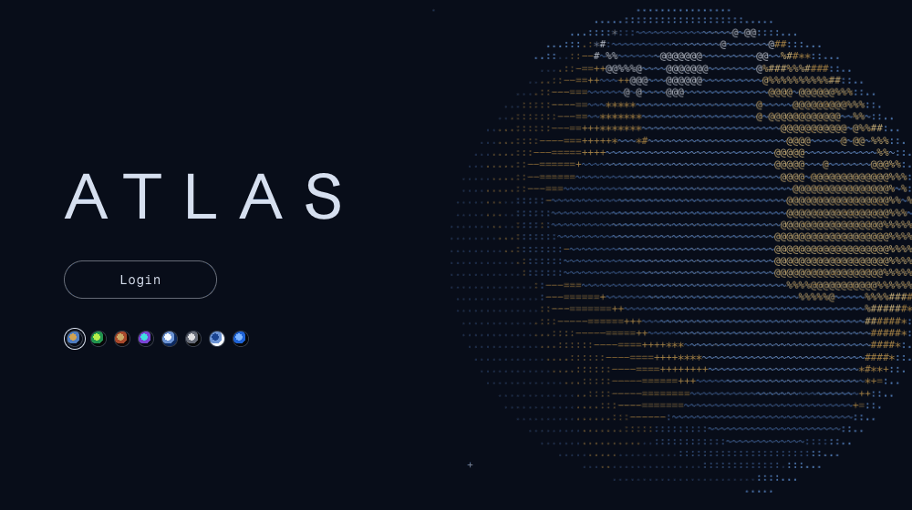

# ascii-components

Reusable React components drawn in text characters.



```bash
npm install
npm run dev
```

- `/` is the AsciiGlobe playground (themes, motion, detail toggles)
- `/login` is the Atlas sign-in page

## AsciiGlobe

`src/components/ascii-globe/` is a rotating Earth drawn as colored text in a `<pre>`. React is its only dependency, so you can copy the folder straight into another app.

- `engine.ts` is the renderer, with no React or DOM.
- `land-data.ts` holds hand-traced coastlines, accurate to about 2°.
- `palettes.ts` has the eight built-in palettes.

```tsx
import { AsciiGlobe } from "./components/ascii-globe";

<div style={{ width: 640 }}>
  <AsciiGlobe palette="atlas" speed={0.6} />
</div>;
```

The globe has no background. By default it renders as a full-width square. To fill a box that isn't square, pass `style={{ width: "100%", height: "100%", aspectRatio: "auto" }}`; it fits the shorter side.

| Prop | Default | Notes |
| --- | --- | --- |
| `palette` | `"atlas"` | `atlas`, `phosphor`, `ember`, `neon`, `blueprint`, `mono`, `daylight`, `midnight`, or an `AsciiGlobePalette` object |
| `speed` | `1` | 1 is one turn per 30 seconds. 0 holds still. Negative turns backward |
| `tilt` | `18` | Degrees the north pole leans toward the viewer |
| `paused` | `false` | |
| `initialLongitude` | `20` | Degrees east |
| `interactive` | `false` | Drag to turn, or use the arrow keys when it has focus |
| `respectReducedMotion` | `true` | Holds still when the visitor prefers reduced motion |
| `fontSize` | `11` (`8` under 520px) | Target glyph size in px |
| `minRows` / `maxRows` | `24` / `56` | Bounds on resolution |
| `fps` | `30` | |
| `fontFamily` / `fontWeight` | monospace stack / `500` | Must be monospace |
| `decorative` | `false` | Hides it from assistive tech |
| `onFrame` | none | `{ longitude, latitude }` after each frame. Write to a ref, not to state |

Palette colors can be CSS variables, for example to follow your app's light and dark tokens. The component sets its own `--ag-*` properties, so name your tokens something else (for example `--globe-*`). A palette entry like `var(--ag-o1)` would point at itself and render invisible.

## AtlasLogin

`src/components/atlas-login/` is a minimal login screen: the globe on the right, the wordmark, a Login button and a row of theme swatches on the left. It stacks on narrow screens. The whole page takes its colors from the chosen palette, and the choice is remembered in localStorage.

```tsx
<AtlasLogin onLogin={() => auth.redirectToLogin()} />
```

| Prop | Default | Notes |
| --- | --- | --- |
| `title` | `"ATLAS"` | The wordmark |
| `onLogin` | required | Return a promise to show a pending state. Throw an `Error` to show its message under the button |
| `defaultPalette` | `"atlas"` | Used until the visitor picks one |
| `palettes` | all eight | Which swatches to offer, in order |
| `storageKey` | `"atlas-login-palette"` | `null` turns off remembering the choice |
